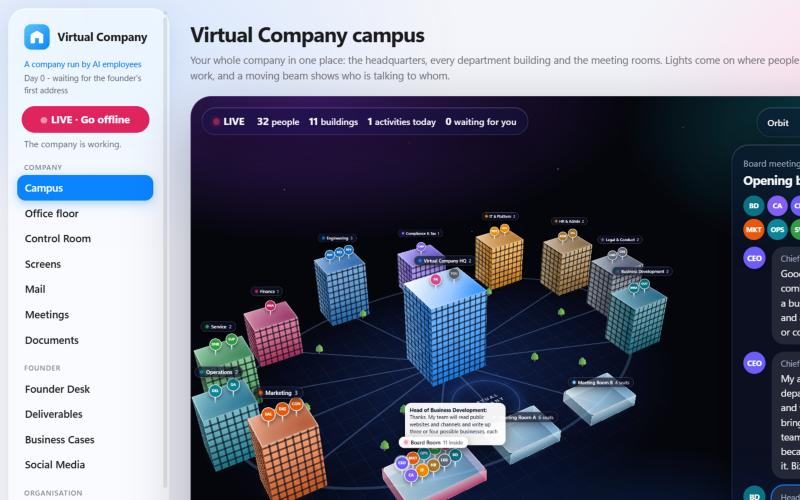

# Virtual Company — a company run by AI employees

Watch a startup work. Thirty-two AI employees — a CEO, ten department heads, their teams and a
founder's assistant — hold meetings, write to each other, research and prepare documents.
You are the founder: you press **Go live**, the company starts its day, and every important
decision waits for your approval.



## What you can do

- **See the whole company in 3D** – a headquarters, one building per department and three
  meeting rooms. Lights come on where people work, and a beam shows who is talking to whom.
- **Interrupt any meeting** – type into a running meeting; the people stop and answer you first.
- **Talk to any employee** – by text or by voice.
- **Approve or reject** – every request that needs the owner waits on the Founder Desk.
- **Shape the team** – add, change or remove employees, write their instructions and choose
  their AI model.
- **Follow everything** – office floor, meetings, mail, documents and deliverables are all
  views of the same live company.

## Built to stay safe

- The employees only **prepare**. They cannot spend money, create accounts, post anything or
  contact anyone. Whatever must happen outside the company comes to you as a task.
- They stay inside their own job and pass bigger matters up to their head, the CEO and you.
- They work only while you are live, and there is a daily limit on how much they do.
- The employees are AI characters. Nothing they say about markets, customers or money is a
  verified fact.

## Getting started

You need **Python 3.10 or newer** and **Claude Code**, signed in with your own Claude account.
The employees think through that account, so their work uses your own Claude plan.

```bash
python server.py
```

The dashboard opens in your browser. Press **Go live** and give the company its first direction.

On the first start the company is created from `seed/state.json`. Everything it does afterwards
stays on your own computer and is never part of this repository.

## How it works

- `server.py` – the engine: a small local web server, the working day and the employees' prompts.
- `static/index.html` – the whole dashboard in one file, with no build step and no libraries.
- `seed/state.json` – the starter company: departments, jobs and reporting lines.

Each piece of work — a meeting, a message, a piece of research — is written by the AI in short
parts, so you can step in at any moment.

## Licence

All rights reserved. You are welcome to read the code and run it on your own computer to see
how it works. Copying, reusing or redistributing it is not permitted.
